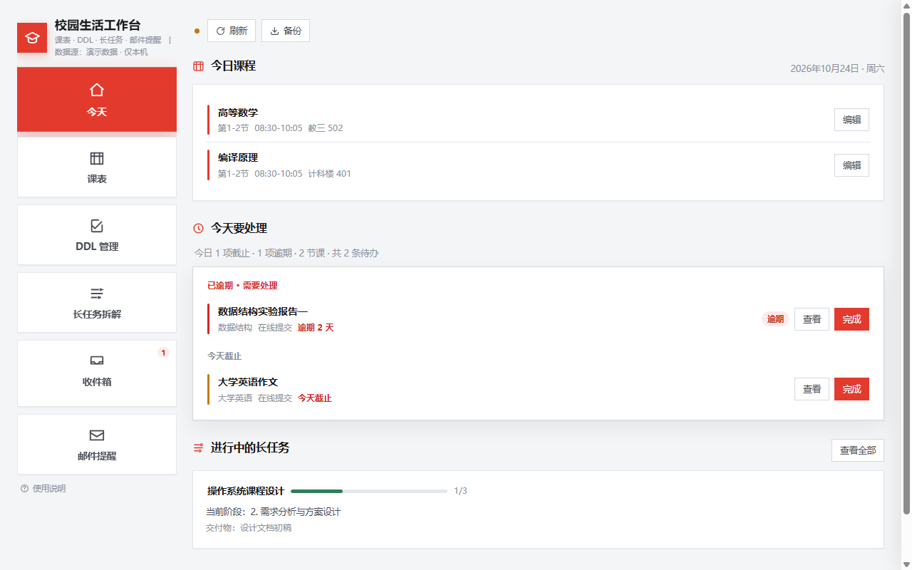
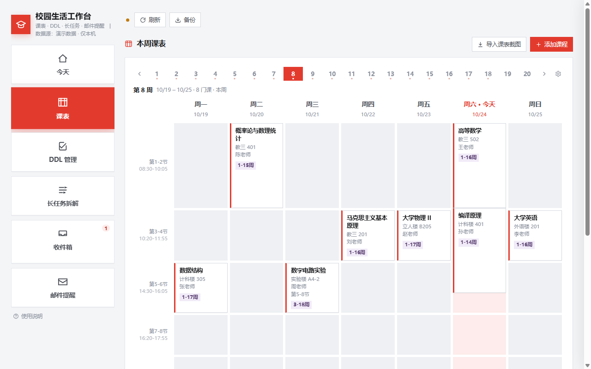
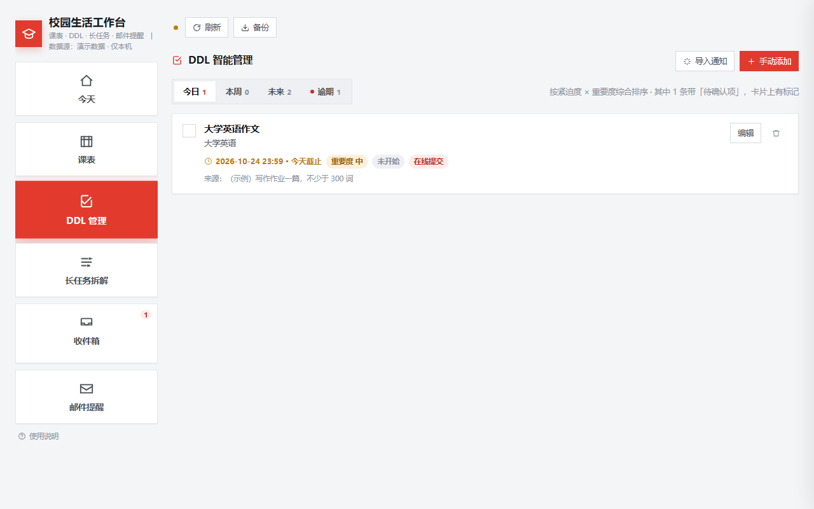
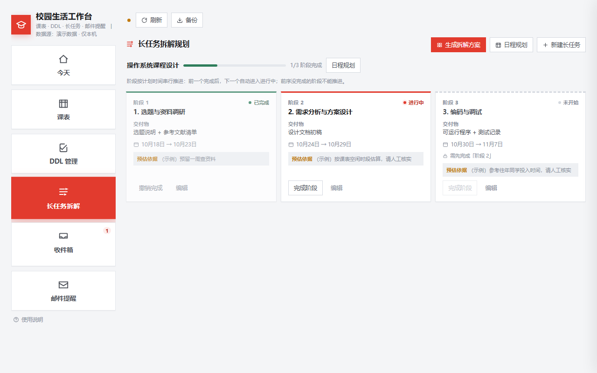
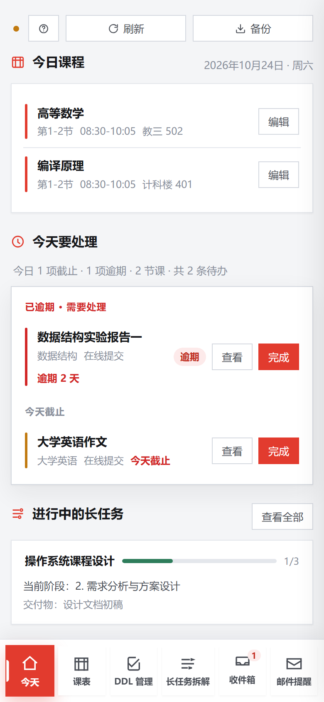

# 校园生活工作台 · Campus Workbench

> 一个 HTML 文件，管住一学期的课表、DDL、大作业、班级群通知和每日提醒。
> 下载下来双击就能看，不需要装任何东西；想让它跨设备同步，再接一个免费的云数据库。

**v1.0.0** ｜ 单文件前端 ｜ 零依赖 ｜ 零构建 ｜ 自带演示数据



---

## 30 秒看效果

1. 下载本仓库（`Code → Download ZIP`，或直接拿发布页的压缩包）
2. 解压，双击 `index.html`
3. 直接进主界面 —— 里面是示例数据，随便点、随便改，不会影响任何人

> 这一步不需要账号、不需要联网、不需要配置任何东西。
> 之所以能这样，是因为文件里没填云服务配置时，页面会自动进入**演示模式**：
> 数据存在浏览器本地，换设备或清缓存就没了。界面左上角会写「演示数据 · 仅本机」。

想让数据跟着账号走，看 [部署到云端](docs/02-部署到云端.md)，大约 20 分钟。

---

## 它管五件事

| 页面 | 解决什么 | 云端表 |
|---|---|---|
| **今天** | 今天有什么课、接下来要交什么、大作业停在哪一步 | 读下面四张表 |
| **课表** | 1–20 周周视图，翻周滚轮，手机自动切成一天一屏；可导入课表截图自动识别 | `courses` |
| **DDL 管理** | 今日 / 本周 / 未来 / 逾期四栏，逾期置顶；可从班级群通知里提取任务 | `ddl_tasks` |
| **长任务拆解** | 把跨几周的大作业拆成阶段，排时间，按依赖顺序推进 | `plan_stages` |
| **收件箱** | QQ 机器人收到的群消息落在这里，确认后转成任务 | `msg_inbox` |
| **邮件提醒** | 每天早上把「今天要做什么」发到邮箱 | `remind_settings` |

三张图看得更清楚：

| 课表 | DDL |
|---|---|
|  |  |

| 长任务拆解 | 手机端 |
|---|---|
|  |  |

---

## 三种用法，按需要选

| | 你要做什么 | 能得到什么 | 耗时 |
|---|---|---|---|
| **A. 只看界面** | 双击 `index.html` | 全部功能都能操作，数据只在本机浏览器 | 0 分钟 |
| **B. 局域网/内网给人用** | 起一个静态服务器 | 同上，多台设备可通过 IP 访问，但各自数据独立 | 2 分钟 |
| **C. 真·多人使用** | 接一个自己的云数据库 | 登录后数据跨设备同步，每人看到自己的课表 | 20–40 分钟 |

A 和 B 不需要注册任何服务。C 需要一个 [WorkBuddy](https://www.workbuddy.cn) 云服务应用（平台托管数据库和登录，免费额度够个人用），
**不接受任何信用卡，也不需要自己写后端**——数据库、登录、AI 识别全部由平台托管，前端直连。

详细步骤见 [快速开始](docs/01-快速开始.md)。

---

## 目录结构

```
campus-workbench/
├── index.html                    ← 主程序（和 campus-workbench.html 内容相同）
├── campus-workbench.html         ← 主程序，改名成这个也能用
├── docs/                         ← 文档
│   ├── 01-快速开始.md
│   ├── 02-部署到云端.md           ← 想多人用看这份
│   ├── 03-数据库结构.md
│   ├── 04-QQ机器人.md             ← 可选能力
│   ├── 05-邮件提醒.md             ← 可选能力
│   ├── 06-常见问题.md
│   ├── 07-二次开发.md
│   ├── 使用手册.md                ← 给最终用户看的
│   └── images/
├── deploy/
│   ├── schema.sql                ← 五张表的建表脚本（含行级权限）
│   └── schema.json               ← 字段清单，本地校验用
├── tools/
│   ├── daily_mail.js             ← 生成并发送每日提醒邮件
│   └── send_mail_html.js         ← 单次发信 / 测 SMTP 通不通
├── skills/
│   └── campus-inbox/SKILL.md     ← QQ 机器人的解析技能
└── samples/
    └── 示例备份.json              ← 可导入的备份文件，用来试「恢复」功能
```

---

## 怎么设计的

**整个前端就是一个 HTML。** CSS 和 JS 全部内联，没有任何 `npm install`、没有打包步骤、没有 CDN 依赖，图标是内联 SVG。
好处很直接：拷到任何地方都能跑，十年后打开还是那个样子，不会因为某个依赖下架而报废。

**后端不是自己写的。** 数据库、手机验证码登录、微信登录、大模型调用都走平台托管服务，前端直连。
所以这个仓库里没有 `server.js`、没有 Dockerfile、没有数据库口令——它本来就不需要。
权限由数据库的行级安全（RLS）保证：每张表每一行都绑定 `owner_id`，登录用户只能读写自己的行。

**没配置也能用。** 文件里 `CLOUD_CFG` 留空时，页面自动切到浏览器本地数据源并灌入示例数据。
这让「拿到文件先看看」和「正式部署」变成同一份代码的两种状态，而不是两个分支。

---

## 可选能力

这两个不是必需的，装上会更省事：

- **QQ 机器人**：在班级群里 @ 它说「下周三交物理实验报告」，网页里的收件箱就多一条 → [接入说明](docs/04-QQ机器人.md)
- **每日邮件**：每天早上把今天的课和要交的东西发到邮箱 → [配置说明](docs/05-邮件提醒.md)

两个都需要在你自己的电脑上跑定时任务，电脑关机时不会执行（会在开机后补发）。

---

## 已知限制

- **手机浏览器不能微信扫码登录**。微信的网站扫码登录在任何手机浏览器里都只给二维码，而二维码就在你自己那块屏幕上，扫不到。
  可行的路：用另一台设备的微信扫，或者干脆用手机号验证码登录。页面里已经把这件事写在按钮上了。
- **微信账号和手机号账号是两套身份**，平台不支持合并，数据互不相通。用哪个登就一直用哪个。
- **课表识别、通知提取这些 AI 功能需要云端模式**（C 类部署），演示模式下不可用。
- 邮件定时任务依赖本机开机；想 7×24 就得放在常开的机器上。

---

## 文档

| 你想… | 看这份 |
|---|---|
| 五分钟内把它跑起来 | [01-快速开始](docs/01-快速开始.md) |
| 接到自己的云数据库，多人使用 | [02-部署到云端](docs/02-部署到云端.md) |
| 搞清五张表有哪些字段 | [03-数据库结构](docs/03-数据库结构.md) |
| 让 QQ 机器人把群消息变成任务 | [04-QQ机器人](docs/04-QQ机器人.md) |
| 配每日邮件提醒 | [05-邮件提醒](docs/05-邮件提醒.md) |
| 打不开 / 白屏 / 数据不见了 | [06-常见问题](docs/06-常见问题.md) |
| 改配色、加字段、动代码 | [07-二次开发](docs/07-二次开发.md) |
| 只是想学会怎么用 | [使用手册](docs/使用手册.md) |

---

## 许可

[MIT](LICENSE)。随便用、随便改、随便商用，保留版权声明即可。

界面、文案、数据库结构可以随意改造。如果把它用在自己的课程或社团里，欢迎告诉我一声。
